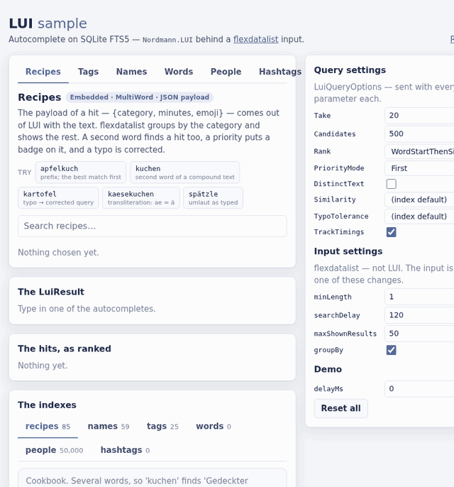
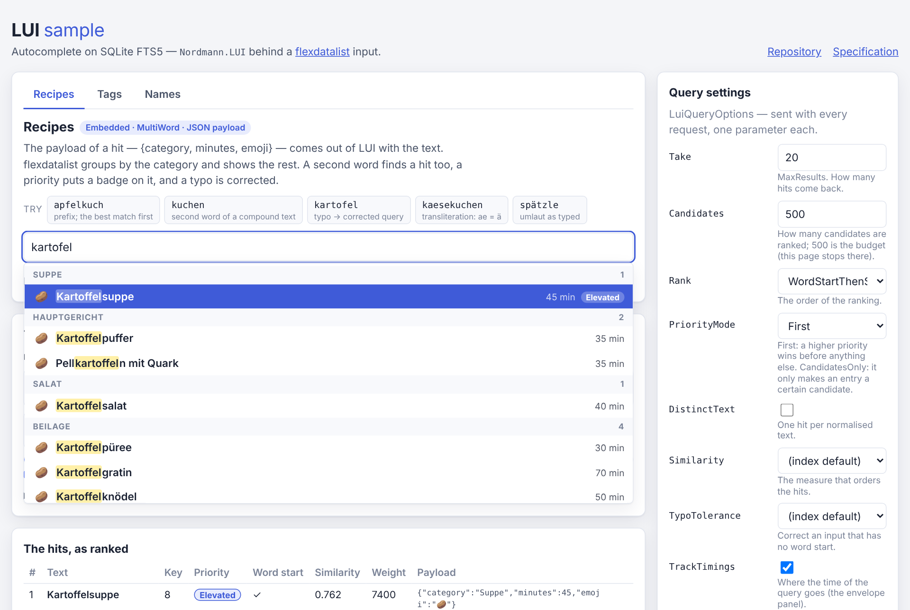
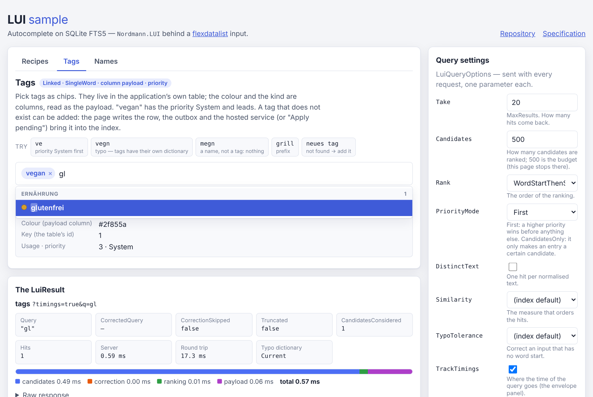

# LUI

> **Autocomplete suggestions for .NET, straight out of your own SQLite database.** The suggestions of a search field: the best 5–20 entries out of a stock of up to a few million short texts.

[](https://github.com/nordmanndev/LUI/actions/workflows/ci.yml) [](https://www.nuget.org/packages/Nordmann.LUI)  [](./LICENSE) [](https://dotnet.microsoft.com/)

## What LUI is

LUI is a **library**, not a server: it puts a fast, typo-tolerant search in front of the data that is already in your
SQLite database. It uses **SQLite FTS5** as its search engine — no second datastore, no service to operate.

**What this is not.** Not a full-text search engine — no BM25, no stemming, no phrase search, no facets; for that,
use Lucene, SeekStorm or FTS5 directly. Not a key–value store. Not a server with its own HTTP interface.

## The problem

98 % of the input of an application is a read: a search field, a dropdown, an autocomplete. The expensive part of such a feature is not the ranking, but the **second store** for the same data — the index beside the database.

## Highlights

- **No second datastore.** The search index lives in your SQLite file, next to your rows.
- **Your rows stay yours.** A `Linked` index keeps no copy of your table and never changes your schema.
- **One typo forgiven.** The correction is per index, off by default, and a query never waits for it.
- **Measured, not promised.** Every performance number has a run behind it, with the machine named.
- **No types in the index.** The type of a payload stands where you use it: `hit.GetPayload<TagChip>()`.

## Contents

- [What LUI is](#what-lui-is) · [The problem](#the-problem) · [Highlights](#highlights) · [Install](#install) · [Quick start](#quick-start)
- [Loading many entries](#loading-many-entries) · [Performance](#performance) · [The kinds of an index](#the-kinds-of-an-index) · [Embedded or linked](#embedded-or-linked)
- [A payload](#a-payload) · [In an ASP.NET Core application](#in-an-aspnet-core-application) · [Only read](#only-read) · [The API](#the-api)
- [The sample application](#the-sample-application) · [The documentation](#the-documentation) · [Status](#status) · [Working on LUI](#working-on-lui) · [Licence](#licence)

## Install

```text
dotnet add package Nordmann.LUI            # the library — all a console application needs
dotnet add package Nordmann.LUI.Hosting    # AddLui and the catalog, for ASP.NET Core or a worker
```

The two packages are released together, with one version; the core starts no thread of its own. They are not on nuget.org yet — the publish pipeline waits for its tag.

## Quick start

```csharp
using Nordmann.LUI;
using var lui = LuiCatalog.Open("Data Source=app.db");

// an index of titles: the words in any order, the spaces optional, one typo forgiven
var recipes = lui.Create("recipes", index => index.MultiWord().TypoTolerance());

recipes.Upsert(1, "Gedeckter Apfelkuchen", weight: 9000);
recipes.Upsert(3, "Bratapfelkuchen", weight: 800);

// the application asks for the dictionary of the typos — a query never does
recipes.WarmUpTypoDictionary();

foreach (var hit in recipes.Search("apfelkuch").Hits)
{
    Console.WriteLine($"{hit.Text} ({hit.Weight})");
}

Console.WriteLine(recipes.Search("apfel gedeckt").Hits[0].Text);
Console.WriteLine(recipes.Search("gedekter").CorrectedQuery);
```

```text
Gedeckter Apfelkuchen (9000)
Bratapfelkuchen (800)
Gedeckter Apfelkuchen
gedeckter
```

`Create` writes — it belongs in the migration of your application; in the runtime path the index is **opened**: `lui.Index("recipes")` reads the definition out of the file and writes nothing.

## Loading many entries

An index that holds more than a few hundred entries is **loaded**, not written one by one. `Sync` makes the index equal
to a set of entries: it reads them in batches, writes them in one transaction per batch, and removes what is gone.

```csharp
// many records at once: Sync makes the index equal to the entries, in batches
using var bulkCatalog = LuiCatalog.Open("Data Source=bulk.db");
var words = bulkCatalog.Create("words", index => index.SingleWord());

var report = words.Sync(
    Enumerable.Range(0, 50_000).Select(i => new LuiEntry(i, $"Wort {i}")),
    new LuiSyncOptions { BatchSize = 10_000 });

Console.WriteLine($"{report.Read} read, {report.Added} added, {report.Batches} batches");
```

```text
50000 read, 50000 added, 5 batches
```

- **`Sync`** is the bulk path: one transaction per batch of `BatchSize` entries, a report at the end, and a
  `IProgress<LuiSyncReport>` for the progress of the load.
- **`UpsertMany`** is the same without the removal: it writes the entries it is given and leaves the rest alone.
- **`Sync`** also takes a stream: `await index.Sync(entries.AsAsyncEnumerable(), …)`.
- **The cost** of a load of a million entries is measured — see [Performance](#performance).

A `Linked` index is loaded differently: its content is the table of the application, so `Sync()` reads the table and
indexes it. The rows that are written afterwards are taken in with `Refresh(id)`, `RefreshMany(ids)` or the triggers the
application asks for.

## Performance

Two measurements, two machines — and both name the machine they stand on.

**The budgets** below are the targets of the specification, measured in their scenario — three million single words of the
German word list and one million titles — on the CI machine: Intel Xeon 2.10 GHz, 4 cores, 15 GB, Ubuntu 24.04,
.NET 10.0.14. Every target is asserted by a test in its scenario; the method and the corpus are in
[`docs/benchmarks.md`](./docs/benchmarks.md).

| Target | Measured | Limit |
|---|---:|---:|
| query p50 | 1.34–1.71 ms | ≤ 2 ms |
| query p95, 1–4 characters | ≤ 3.1 ms | ≤ 5 ms |
| query p95, 5–8 characters | 13.4–17.5 ms | ≤ 20 ms |
| query with a typo correction, p95 | 27.9–32.5 ms | ≤ 35 ms |
| allocation per query, p50 / p95 | 46 / 51 KB | ≤ 60 / ≤ 100 KB |
| `Upsert` / `UpdateWeight` / `Remove`, p95 | 0.51–0.78 ms | ≤ 1 ms |
| first load of 3 M entries (`Sync`) | 172.5–205.9 s | ≤ 4 min (#32) |
| typo dictionary of 685,829 words | 138 MB, 4.1–4.8 s | ≤ 200 MB, ≤ 10 s |
| file of 1 M titles | 457 MB | ≤ 500 MB |

The **limits** are the targets of the specification — a test reads them out of the contract and fails when this table
drifts from it (issue #38). The **measured values** are the numbers of the last measurement of each row: the latencies,
the build and the size of the file from the CI machine (2026-11-05, before the allocation was lowered — so they are an
upper bound); the allocation in bytes, and therefore independent of the machine (2026-11-06, the current code).

**The tables** below are the output of [BenchmarkDotNet](https://benchmarkdotnet.org/) — the code on the corpus of the
measurement, not the scenario of the budgets. They are rendered from the reports of the run in
[`benchmarks/results/`](./benchmarks/results/) by a test, so they cannot drift from them; the machine of the run stands
above them.

<!-- benchmarks:begin -->
<!-- generated by Readme_Benchmarks from benchmarks/results/ — do not edit by hand -->

```text
BenchmarkDotNet v0.15.8, Linux Debian GNU/Linux 12 (bookworm)
Intel Xeon 6982P-C 3.80GHz, 1 CPU, 2 logical and 2 physical cores
.NET SDK 10.0.403
  [Host]     : .NET 10.0.14 (10.0.14, 10.0.1426.52326), X64 RyuJIT x86-64-v4
  DefaultJob : .NET 10.0.14 (10.0.14, 10.0.1426.52326), X64 RyuJIT x86-64-v4
```

#### A query

One query through the whole pipeline: the prefix path for one and two characters, FTS5 from three — Entries = 200000. `QueryBenchmarks`.

| Method | Kind | Input | Mean | Error | Allocated |
|---|---|---|---:|---:|---:|
| Search | SingleWord | apfelkuc | 89.42 μs | 1.719 μs | 6.73 KB |
| Search | SingleWord | b | 375.32 μs | 6.873 μs | 36.4 KB |
| Search | SingleWord | haus | 504.50 μs | 9.855 μs | 27.04 KB |
| Search | SingleWord | ka | 16.46 μs | 0.275 μs | 4.94 KB |
| Search | MultiWord | apfelkuc | 238.05 μs | 48.295 μs | 5.44 KB |
| Search | MultiWord | b | 463.08 μs | 8.753 μs | 60.54 KB |
| Search | MultiWord | haus | 867.40 μs | 17.324 μs | 65.67 KB |
| Search | MultiWord | ka | 507.16 μs | 10.049 μs | 61.78 KB |

#### A query with a typo correction

A single-word index with typo tolerance, the dictionary built; the input has one typo — Entries = 200000. `CorrectionBenchmarks`.

| Method | Input | Mean | Error | Allocated |
|---|---|---:|---:|---:|
| Search | bahmhof | 201.66 μs | 3.842 μs | 23.61 KB |
| Search | fusbal | 371.00 μs | 7.259 μs | 21.33 KB |
| Search | kartofel | 85.87 μs | 1.370 μs | 7.22 KB |
| Search | strasee | 94.57 μs | 1.089 μs | 7.17 KB |

#### A single write

One write in a transaction of its own — Entries = 200000. `WriteBenchmarks`.

| Method | Mean | Error | Allocated |
|---|---:|---:|---:|
| UpdateWeight | 1,868.1 μs | 36.99 μs | 436 B |
| UpsertTheSame | 688.0 μs | 3.93 μs | 820 B |
| UpsertAnotherText | 1,496.3 μs | 29.42 μs | 820 B |

#### The search form and the similarity

Per text, no database: the normalisation of §6 and two similarity measures against `apfelku`; BenchmarkDotNet shortens a long text — `Gedec(...)useln [35]` is „Gedeckter Apfelkuchen mit Streuseln", `Größe(...)nahme [23]` „Größenänderungsmaßnahme". `TextBenchmarks`.

| Method | Text | Mean | Error | Allocated |
|---|---|---:|---:|---:|
| SearchForm | Apfelkuchen | 43.72 ns | 0.408 ns | 144 B |
| JaroWinkler | Apfelkuchen | 41.64 ns | 0.861 ns | - |
| NgramDice | Apfelkuchen | 95.53 ns | 1.229 ns | - |
| SearchForm | Gedec(...)useln [35] | 97.19 ns | 1.462 ns | 240 B |
| JaroWinkler | Gedec(...)useln [35] | 78.58 ns | 1.509 ns | - |
| NgramDice | Gedec(...)useln [35] | 251.99 ns | 5.046 ns | - |
| SearchForm | Größe(...)nahme [23] | 100.69 ns | 2.073 ns | 320 B |
| JaroWinkler | Größe(...)nahme [23] | 70.50 ns | 1.447 ns | - |
| NgramDice | Größe(...)nahme [23] | 182.70 ns | 3.655 ns | - |

<!-- benchmarks:end -->

## The kinds of an index

The kind is decided **once**, when the index is created, and it decides how a query searches. The caller of a query does
not have to know it.

| | **`SingleWord`** | **`MultiWord`** |
|---|---|---|
| **For** | tags, single words, compounds, hashtags | names, recipe and book titles |
| **Examples** | `Apfelkuchen`, `#Bahnhof`, `vegan` | `Anna Müller`, `Gedeckter Apfelkuchen` |
| **The input is** | one unit | split into words, **ANDed** |
| **The order of the words** | — | does not matter: `kuchen apfel` finds what `apfel kuchen` finds |
| **The spaces** | — | do not matter: `apfelkuch` finds “Apfel Kuchen” |
| **The default similarity** | Jaro-Winkler | N-gram Dice |

### The four combinations

The typo tolerance is a decision of the application: the dictionary of the words of an index costs 138 MB for 685,829
words, so it is **off by default** and switched on with `TypoTolerance()`.

| | **Typo tolerance off** (the default) | **Typo tolerance on** |
|---|---|---|
| **`SingleWord`** | the text as one unit: `apfelkuch` finds *Apfelkuchen* | + one error in the word: `apfelkuh` finds *Apfelkuchen* |
| **`MultiWord`** | the words ANDed: `apfelkuch` finds *Apfel Kuchen*, `kuchen apfel` finds it too | + one error in one of the words: `apfle kuchen` finds *Apfel Kuchen* |

A correction happens only when **no candidate** matches the input at the beginning of a word — 34 % of the typos would
find hits in the middle of other words. The dictionary belongs to the index: a query in a tag index never corrects
towards the words of a name index.

**The dictionary is built on request.** `WarmUpTypoDictionary()` reads the content table and builds it — at three million
entries that is seconds and 138 MB, which the application should not pay at the start. A query never builds it: it
answers with what the input found, sets `CorrectionSkipped` and waits for the application to ask for the build.

## Embedded or linked

The content of an index comes either from the library's own table or from a table of the application. Three questions
decide it.

1. **Do the rows already live in a table of your application?**
   **Yes** → take **Linked**: the library indexes your table and keeps no copy of the text.
   **No** → take **Embedded**: the library keeps the text in its own table `lui_<index>`.
2. **Who writes those rows?**
   **You, with SQL or with your ORM** → with **Embedded** you write the text twice: once into your table, once into
   the index. With **Linked** you write it once and tell the index afterwards.
   **Nobody yet — the texts come from a file, an API or a list** → **Embedded**; the index is the only place the text is.
3. **Do you need a weight of your own — clicks, a popularity, a stock?**
   **Yes** → with **Embedded** the weight is a property of the entry. With **Linked** it is a column of your table, and
   the index reads it.

| | **`Embedded`** (the default) | **`Linked`** |
|---|---|---|
| **The text lives in** | the table of the library, `lui_<index>` | your own table |
| **You write it with** | `Upsert`, `UpsertMany`, `Remove` | ordinary SQL — then `Refresh(id)`, `Sync()` or the triggers you ask for |
| **A copy of the text** | yes | **no** |
| **Your schema** | untouched | untouched — no column, no index, no trigger unless you ask for one |
| **A hit reads** | the copy in the index | your row, live |
| **Your own file** | possible | not possible — the index is in the file of your table |

The two are independent of the kind of the index: every combination of them exists. A `Linked` index keeps the
normalised text in the search index and the weight and the priority in the order of the candidates — your row itself
is never copied.

## A payload

A hit can carry a payload of your own: a category, a colour, an id of yours. It is any type of the JSON context of
your application, written by the **serialiser of the catalog** — source-generated, and so safe for trimming and AOT.

```csharp
using Nordmann.LUI;
using var withChips = LuiCatalog.Open("Data Source=chips.db", new LuiCatalogOptions
{
    PayloadSerializer = LuiPayloadSerializer.Json(TagJson.Default),   // one serialiser for every index of the catalog
});

var chips = withChips.Create("chips", index => index.SingleWord());
chips.Upsert(new LuiEntry(1, "vegan") { Weight = 120, Payload = new TagChip("#3a3", "System") });

var chip = chips.Search("veg").Hits[0].GetPayload<TagChip>();   // the type stands where the payload is used
Console.WriteLine(chip!.Colour);                                 // #3a3
```

```csharp
// The types of the application: a payload is any type of its JSON context
using System.Text.Json.Serialization;

public sealed record TagChip(string Colour, string Group);

[JsonSerializable(typeof(TagChip))]
public sealed partial class TagJson : JsonSerializerContext;
```

The index knows no types: the file stores the payload as bytes, and the type stands where the payload is used — a
payload that cannot be read is a `LuiPayloadException`.

## In an ASP.NET Core application

`Nordmann.LUI.Hosting` brings the dependency injection: `AddLui` puts the **catalog** into the container — and
nothing else. An index is not registered and not injected; the application asks the catalog for it.

```csharp
using Microsoft.Extensions.DependencyInjection;
using Microsoft.Extensions.Hosting;

var builder = Host.CreateApplicationBuilder();
builder.Services.AddLui("Data Source=app.db");

using var host = builder.Build();
host.Start();

// in an endpoint: the catalog is injected — the index is asked for
var catalog = host.Services.GetRequiredService<LuiCatalog>();
var suggest = catalog.Index("recipes");
Console.WriteLine(suggest.Search("apfelkuch").Hits[0].Text);   // Gedeckter Apfelkuchen
```

The hosting package carries the dependency injection — and, if you ask for it, the **warm-up**:

```csharp
builder.Services.AddLui("Data Source=app.db");
builder.Services.AddLuiWarmup();     // the dictionaries at the start, the outbox every 30 s
```

`AddLuiWarmup()` registers a service of the host: the typo dictionaries of your indexes are built while the host starts
(so the first query already corrects a typo), and the outbox of a linked index — the rows the triggers noted — is
applied every 30 seconds. **Off by default**: without the call, the host starts nothing of LUI.

The library starts no thread of its own — the host runs the service, stops it and disposes it. And the library still
carries no timer of its own: the rebuild of a dictionary stays with your application, because only you know when a
phase is quiet.

## Only read

Sometimes an application may only read: a replica, a file that is read-only. A catalog opened with
`Mode=ReadOnly` writes nothing — no WAL, no `lui_meta` — and every write is refused with a `LuiReadOnlyException`.

```csharp
// the same file, opened for reading only: it reads and searches, and it writes nothing
using var reader = LuiCatalog.Open("Data Source=app.db;Mode=ReadOnly");
var opened = reader.Index("recipes");

foreach (var hit in opened.Search("apfelkuch").Hits)
{
    Console.WriteLine($"{hit.Key}: {hit.Text}");   // 1: Gedeckter Apfelkuchen
}
```

`Index` reads the definition out of the file and writes nothing — no table, no definition, no write lock. The file
decides what may happen.

## The API

| Type | What it is |
|---|---|
| `LuiCatalog` | the entry point: `Open`, `Create`, `Index`, `LinkedIndex`, `DropIndex` |
| `LuiEntry` | what is written: a key, a text, a weight, a priority, a payload |
| `LuiKey` | the key of the application: a number or a text — `1` and `"1"` are different keys |
| `LuiQuery` | a query that is configured step by step: `Take`, `Candidates`, `Rank`, `PriorityMode`, `DistinctText`, `Similarity`, `TypoTolerance`, `TrackTimings` |
| `LuiQueryOptions` | the same settings as a record, for the configuration of an application |
| `LuiResult` | the answer of a query: the hits, the candidates it considered, the query it corrected |
| `LuiHit` | one hit: the key, the text, the weight, the priority, the similarity — and `GetPayload<T>()` |
| `LuiCatalogOptions` | the settings of the catalog: the cache, the memory map, the busy timeout, the WAL, the payload serialiser, the clock |

**Every public type of the package is listed in [`docs/api.md`](./docs/api.md)** — the catalogue, the builders, the
index, the entry, the query, the payload, the similarity, the enumerations, the exceptions and the hosting extension,
with a sentence for each.

## The sample application

```bash
dotnet run --project samples/Lui.Sample      # http://localhost:5000
```

[`samples/Lui.Sample/`](./samples/Lui.Sample/) is an ASP.NET Core application with six autocompletes: recipes with
a JSON payload, tags **linked** to your own table, names, the German word list and two bulk indexes. The bulk indexes
are **created on demand** — the page fills them when you ask for it, and shows the progress while it does.







## The documentation

| | |
|---|---|
| **[The map of the documentation](./docs/README.md)** | what lies where: the entrance, the way, the API, the numbers — and who reads what |
| **[The tutorial](./docs/tutorial/README.md)** | the way: from an empty database to a working autocomplete, in five steps |
| **[The API](./docs/api.md)** | every public type of the package, with a sentence for each |
| **[The benchmarks](./docs/benchmarks.md)** | every measured number, with the machine, the corpus and the method |
| **[The normalisation](./docs/normalization.md)** | the rule that turns a text into a searchable form — and what was measured about it |
| **[The test map](./docs/testing.md)** | which test proves which rule |
| **[The alignment](./docs/architecture/alignment.md)** and **[the domain](./docs/domain/lui.md)** | which rules of the standards apply to a library — and the terms the library speaks |

## Status

LUI is **feature-complete for 0.1.0 and not yet published**. The design is specified, and the implementation follows
it; every decision of the repository is written down and dated.

Two packages, one version: `Nordmann.LUI` (the library) and `Nordmann.LUI.Hosting` (the dependency injection). The core
takes `Microsoft.Data.Sqlite` and `symspell` and nothing else; the target framework is `net10.0`, the licence is MIT,
and the public API grows only additively from `0.1.0` on.

## Working on LUI

Read [`AGENTS.md`](./AGENTS.md) first — it is the contract for this repository, and it inherits
[`nordmanndev/standards`](https://github.com/nordmanndev/standards).

- **One issue, one pull request**, each with its tests, its measurement and — for a decision that changes the public
  API, the schema or the dependencies — its record.
- **Before a pull request:** `dotnet test`, `dotnet format --verify-no-changes`, `tools/package-smoke-test.sh`,
  `tools/mutation-check.sh` — the test map ([`docs/testing.md`](./docs/testing.md)) is a guard: an unlisted test file fails the build.
- **The code of this README runs.** Every C# block above is executed by the package smoke test, against the packed
  `.nupkg` — so the README cannot drift from the code.

## Licence

MIT — see [`LICENSE`](./LICENSE).
