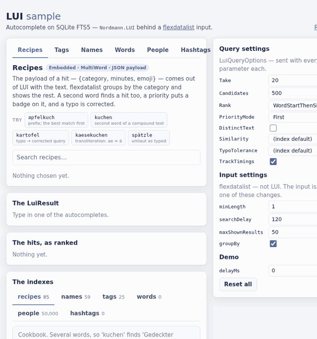
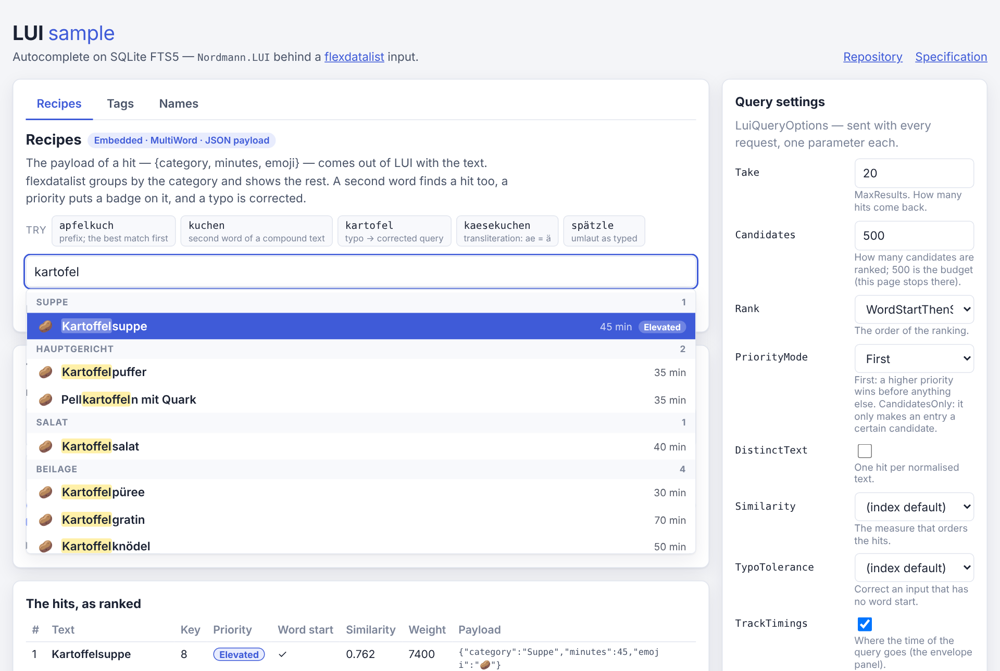

# LUI

> **Autocomplete suggestions for .NET, straight out of your own SQLite database.** The suggestions of a search field: the best 5–20 entries out of a stock of up to a few million short texts.

[](https://github.com/nordmanndev/LUI/actions/workflows/ci.yml) [](https://www.nuget.org/packages/Nordmann.LUI)  [](./LICENSE) [](https://dotnet.microsoft.com/)

## What LUI is

LUI is a **library**, not a server: it puts a fast, typo-tolerant search in front of the data that is already in your
SQLite database. It uses **SQLite FTS5** as its search engine — no second datastore, no service to operate.

**What this is not.** Not a full-text search engine — no BM25, no stemming, no phrase search, no facets; for that,
use Lucene, SeekStorm or FTS5 directly. Not a key–value store. Not a server with its own HTTP interface.

## The problem

98 % of the input of an application is a read: a search field, a dropdown, an autocomplete. The expensive part of such a feature is not the ranking, but the **second store** for the same data — the index beside the database.

## Highlights

- **No second datastore.** The search index lives in your SQLite file, next to your rows.
- **Your rows stay yours.** A `Linked` index keeps no copy of your table and never changes your schema.
- **One typo forgiven.** The correction is per index, off by default, and a query never waits for it.
- **Measured, not promised.** Every performance number has a run behind it, with the machine named.
- **Typed from the definition.** The key type and the payload type are declared once, in the definition of the index: `hit.Key`, `hit.Payload`.

## Contents

- [What LUI is](#what-lui-is) · [The problem](#the-problem) · [Highlights](#highlights) · [Install](#install) · [Quick start](#quick-start)
- [Loading many entries](#loading-many-entries) · [Performance](#performance) · [The kinds of an index](#the-kinds-of-an-index) · [Embedded or linked](#embedded-or-linked) · [Linked indexes and the sync](#linked-indexes-and-the-sync) · [Starting up](#starting-up-initialize-and-the-host-pattern)
- [A payload](#a-payload) · [In an ASP.NET Core application](#in-an-aspnet-core-application) · [Only read](#only-read) · [The API](#the-api)
- [The sample application](#the-sample-application) · [The documentation](#the-documentation) · [Status](#status) · [Working on LUI](#working-on-lui) · [Licence](#licence)

## Install

```text
dotnet add package Nordmann.LUI            # the library — all a console application needs
dotnet add package Nordmann.LUI.Hosting    # AddLui and the catalog, for ASP.NET Core or a worker
```

The two packages are released together, with one version; the core starts no thread of its own. The version is
`0.3.0`, and the public API grows only additively from here on — the freeze of `0.1.0` was lifted once, for this version
(see [Status](#status)).

## Quick start

```csharp
using Nordmann.LUI;
using var lui = LuiCatalog.OpenOrCreate("app.db");

// an index of titles: the words in any order, the spaces optional, one typo forgiven
var recipesIndex = new LuiIndexDefinition<long>("recipes", index => index.MultiWord().TypoTolerance());
var recipes = lui.Create(recipesIndex);

recipes.Upsert(1, "Gedeckter Apfelkuchen", weight: 9000);
recipes.Upsert(3, "Bratapfelkuchen", weight: 800);

// the application asks for the dictionary of the typos — a query never does
recipes.WarmUpTypoDictionary();

foreach (var hit in recipes.Search("apfelkuch").Hits)
{
    Console.WriteLine($"{hit.Text} ({hit.Weight})");
}

Console.WriteLine(recipes.Search("apfel gedeckt").Hits[0].Text);
Console.WriteLine(recipes.Search("gedekter").CorrectedQuery);
```

```text
Gedeckter Apfelkuchen (9000)
Bratapfelkuchen (800)
Gedeckter Apfelkuchen
gedeckter
```

`Create` writes — it belongs in the migration of your application; in the runtime path the index is **opened**: `lui.Index(recipesIndex)` compares the definition with the one in the file and writes nothing.

At the start of a real application the dictionary is one of several start steps — `catalog.Initialize()` does all of them for every index in one call: see [Starting up](#starting-up-initialize-and-the-host-pattern).

## Loading many entries

An index that holds more than a few hundred entries is **loaded**, not written one by one. `Sync` makes the index equal
to a set of entries: it reads them in batches, writes them in one transaction per batch, and removes what is gone.

```csharp
// many records at once: Sync makes the index equal to the entries, in batches
using var bulkCatalog = LuiCatalog.OpenOrCreate("bulk.db");
var words = bulkCatalog.Create(new LuiIndexDefinition<long>("words", index => index.SingleWord()));

var report = words.Sync(
    Enumerable.Range(0, 50_000).Select(i => new LuiEntry<long>(i, $"Wort {i}")),
    new LuiSyncOptions { BatchSize = 10_000 });

Console.WriteLine($"{report.Read} read, {report.Added} added, {report.Batches} batches");
```

```text
50000 read, 50000 added, 5 batches
```

- **`Sync`** is the bulk path: one transaction per batch of `BatchSize` entries, a report at the end, and a
  `IProgress<LuiSyncReport>` for the progress of the load.
- **`UpsertMany`** is the same without the removal: it writes the entries it is given and leaves the rest alone.
- **`Sync`** also takes a stream: `await index.Sync(entries.AsAsyncEnumerable(), …)`.
- **The cost** of a load of a million entries is measured — see [Performance](#performance).

A `Linked` index is loaded differently: its content is the table of the application, so `Sync()` reads the table and
indexes it. The rows that are written afterwards are taken in with `Refresh(id)`, `RefreshMany(ids)` or the triggers the
application asks for.

## Performance

Two measurements, two machines — and both name the machine they stand on.

**The budgets** below are the promises of the repository: they live in one file
([`tests/Nordmann.LUI.Testing/Budgets/budgets.json`](./tests/Nordmann.LUI.Testing/Budgets/budgets.json), ADR-0056), and
each of them carries its scenario, its limit, its unit and its kind. The scenario of the latency budgets is three million
single words of the German word list — and the list has 1,908,798 entries, so that scenario is **not reached yet** (#176):
the lane reports those numbers for the entries it has and asserts the sizes (ADR-0041). The numbers in the table are the
lane of 2026-11-19 on a hosted runner (Ubuntu 24.04, 4 cores, .NET 10.0.15) — **not the machine of the budgets**; the method
and the corpus are in [`docs/benchmarks.md`](./docs/benchmarks.md).

| Target | Measured | Limit |
|---|---:|---:|
| query p50 | 0.87 ms | ≤ 2 ms |
| query p95, 1–4 characters | ≤ 1.7 ms | ≤ 5 ms |
| query p95, 5–8 characters | ≤ 4.5 ms | ≤ 20 ms |
| query with a typo correction, p95 | 8.4 ms | ≤ 35 ms |
| allocation per query, p50 / p95 | 20 / 44 KB | ≤ 60 / ≤ 100 KB |
| `Upsert` / `UpdateWeight` / `Remove`, p95 | 0.51–0.78 ms (2026-11-05) | ≤ 1 ms |
| first load of 3 M entries (`Sync`) | 67.0 s for 1.9 M entries | ≤ 3 min (#32) |
| typo dictionary of 685,739 words | 194 MB, 4.0–5.2 s | ≤ 200 MB, ≤ 10 s |
| typo dictionary of two errors, 685,739 words | 388 MB | ≤ 420 MB |
| file of 1 M titles | 243 MB | ≤ 500 MB |

The **limits** live in one file — [`tests/Nordmann.LUI.Testing/Budgets/budgets.json`](./tests/Nordmann.LUI.Testing/Budgets/budgets.json)
(ADR-0056) — and a test reads them out of it and fails when this table drifts from it (issue #38). The **measured
values** are the numbers of the last measurement of each row, with its date and its machine: the query, the allocation, the
build, the file and the dictionary of one error are from the lane of 2026-11-19 (run 9, the entries of the word list — not three million), a write from the CI of
2026-11-05 (the lane does not report it for the entries it has); a time belongs to the machine it was measured on
([ADR-0041](.agents/adr/0041-the-budgets-of-16-run-on-a-schedule.md)). The typo dictionary was measured again on
2026-11-19 — **4.0–5.2 s** for **194 MB** with one error, **10.7–12.2 s** for **388 MB** with two
([`docs/typo-dictionary.md`](./docs/typo-dictionary.md)). The 138 MB and 240 MB that stood here before could not be
reproduced — the same code of `0.1.1`, `0.2.0` and this version gives 194 and 388 MB here (a Linux container and a hosted
runner); why the first measurements were lower is not known.
A measured value does **not** live in the file: it belongs to a run and to its machine, and a file that carried it would
be a second truth beside the promise.

**A write waits for the disk**, so every report names the disk its databases lived on, and a test fails on a report that was
measured on a network drive: on the local disk (ext4) of the run of 2026-11-19 a single write — `Upsert`, `UpdateWeight`,
one transaction each — takes **0.13–0.33 ms** on average (the container of the round, not the machine of the budgets;
issue #178).

**The tables** below are the output of [BenchmarkDotNet](https://benchmarkdotnet.org/) — the code on the corpus of the
measurement, not the scenario of the budgets. They are rendered from the reports of the run in
[`benchmarks/results/`](./benchmarks/results/) by a test, so they cannot drift from them; the machine of the run stands
above them. **Every line names the number of hits its query found** — a line without it can measure nothing and look
healthy (the input `ka` found nothing in the report of the day), and a line that measures no query says so with a dash
(issue #124).

<!-- benchmarks:begin -->
<!-- generated by ReadmeBenchmarksTests from benchmarks/results/ — do not edit by hand -->

```text
BenchmarkDotNet v0.15.8, Linux Ubuntu 24.04.5 LTS (Noble Numbat)
Intel Xeon Processor 2.30GHz, 1 CPU, 4 logical and 4 physical cores
.NET SDK 10.0.114
  [Host]     : .NET 10.0.14 (10.0.14, 10.0.1426.52326), X64 RyuJIT x86-64-v4
  DefaultJob : .NET 10.0.14 (10.0.14, 10.0.1426.52326), X64 RyuJIT x86-64-v4
  [Run]      : 2026-11-19, the measurements per case: 13–80
  [Machine]  : Intel Xeon Processor 2.30GHz, 1 CPU, 4 logical and 4 physical cores
  [Journal]  : wal
  [Disk]     : ext4, local — /tmp/lui-bench.leE5Mc/tmp
```

#### A query

One query through the whole pipeline: the prefix path for one and two characters, FTS5 from three — Entries = 200000, Candidates = 500, Order = Start/Sim, Similarity = JaroWinkler, Correction = False. `QueryBenchmarks`.

| Method | Corpus | Input | Source | Mean | CI 99.9 % | Allocated | Hits |
|---|---|---|---|---:|---:|---:|---:|
| Search | titles | apfelkuc | Embedded | 80.49 μs | 1.589 μs | 5.2 KB | 0 |
| Search | titles | apfelkuc | Linked | 81.04 μs | 1.598 μs | 5.24 KB | 0 |
| Search | titles | b | Embedded | 138.73 μs | 2.344 μs | 14.88 KB | 500 |
| Search | titles | b | Linked | 346.38 μs | 6.175 μs | 43.22 KB | 500 |
| Search | titles | haus | Embedded | 489.59 μs | 8.890 μs | 51.03 KB | 500 |
| Search | titles | haus | Linked | 564.32 μs | 8.047 μs | 113.76 KB | 500 |
| Search | titles | ka | Embedded | 139.17 μs | 0.329 μs | 14.73 KB | 500 |
| Search | titles | ka | Linked | 366.86 μs | 7.253 μs | 42.64 KB | 500 |
| Search | words | apfelkuc | Embedded | 116.70 μs | 2.260 μs | 6.53 KB | 1 |
| Search | words | apfelkuc | Linked | 116.57 μs | 2.299 μs | 6.57 KB | 1 |
| Search | words | b | Embedded | 143.17 μs | 2.768 μs | 14.63 KB | 500 |
| Search | words | b | Linked | 312.43 μs | 5.459 μs | 39.62 KB | 500 |
| Search | words | haus | Embedded | 597.45 μs | 11.865 μs | 41.49 KB | 500 |
| Search | words | haus | Linked | 537.39 μs | 2.658 μs | 41.59 KB | 500 |
| Search | words | ka | Embedded | 138.76 μs | 1.600 μs | 14.57 KB | 500 |
| Search | words | ka | Linked | 345.86 μs | 6.887 μs | 39.68 KB | 500 |

#### The settings of a query

The budget of the candidates, the order of the ranking, the measure of the similarity and the correction on and off — each of them is measured, not described — Corpus = words, Entries = 200000, Input = haus, Source = Embedded. `SettingsBenchmarks`.

| Method | Candidates | Order | Similarity | Correction | Mean | CI 99.9 % | Allocated | Hits |
|---|---|---|---|---|---:|---:|---:|---:|
| Search | 500 | Start/Sim | JaroWinkler | False | 587.7 μs | 11.69 μs | 41.49 KB | 500 |
| Search | 500 | Start/Sim | JaroWinkler | True | 585.8 μs | 11.57 μs | 41.49 KB | 500 |
| Search | 500 | Start/Sim | Levenshtein | False | 624.6 μs | 12.39 μs | 41.49 KB | 500 |
| Search | 500 | Start/Sim | Levenshtein | True | 621.1 μs | 12.39 μs | 41.49 KB | 500 |
| Search | 500 | WeightOnly | JaroWinkler | False | 489.1 μs | 9.74 μs | 40.75 KB | 500 |
| Search | 500 | WeightOnly | JaroWinkler | True | 518.2 μs | 9.33 μs | 40.75 KB | 500 |
| Search | 500 | WeightOnly | Levenshtein | False | 488.0 μs | 9.72 μs | 40.75 KB | 500 |
| Search | 500 | WeightOnly | Levenshtein | True | 541.4 μs | 12.10 μs | 40.75 KB | 500 |
| Search | 2000 | Start/Sim | JaroWinkler | False | 1,497.6 μs | 33.96 μs | 184.68 KB | 1090 |
| Search | 2000 | Start/Sim | JaroWinkler | True | 1,573.6 μs | 47.77 μs | 184.68 KB | 1090 |
| Search | 2000 | Start/Sim | Levenshtein | False | 1,621.1 μs | 17.95 μs | 184.68 KB | 1090 |
| Search | 2000 | Start/Sim | Levenshtein | True | 1,630.3 μs | 44.72 μs | 184.68 KB | 1090 |
| Search | 2000 | WeightOnly | JaroWinkler | False | 1,212.6 μs | 31.49 μs | 183.82 KB | 1090 |
| Search | 2000 | WeightOnly | JaroWinkler | True | 1,401.5 μs | 42.56 μs | 183.82 KB | 1090 |
| Search | 2000 | WeightOnly | Levenshtein | False | 1,236.7 μs | 31.28 μs | 183.82 KB | 1090 |
| Search | 2000 | WeightOnly | Levenshtein | True | 1,435.7 μs | 41.06 μs | 183.82 KB | 1090 |

#### A query with a typo correction

A single-word index with typo tolerance, the dictionary built; the input has one typo — Corpus = words, Entries = 200000, Candidates = 500, Order = Start/Sim, Similarity = JaroWinkler, Correction = True, Source = Embedded. `CorrectionBenchmarks`.

| Method | Input | Mean | CI 99.9 % | Allocated | Hits |
|---|---|---:|---:|---:|---:|
| Search | bahmhof | 276.8 μs | 5.51 μs | 25.53 KB | 99 |
| Search | fusbal | 561.9 μs | 9.36 μs | 27.98 KB | 118 |
| Search | kartofel | 591.6 μs | 11.83 μs | 23.71 KB | 72 |
| Search | strasee | 1,320.7 μs | 26.40 μs | 42.86 KB | 402 |

#### A single write

One write in a transaction of its own — Entries = 200000. `WriteBenchmarks`.

| Method | Mean | CI 99.9 % | Allocated | Hits |
|---|---:|---:|---:|---:|
| UpdateWeight | 334.6 μs | 12.54 μs | 2.73 KB | — |
| UpsertTheSame | 131.0 μs | 2.60 μs | 3.96 KB | — |
| UpsertAnotherText | 306.9 μs | 23.53 μs | 3.96 KB | — |

#### The search form and the similarity

Per text, no database: the normalisation of ADR-0005 and two similarity measures against `apfelku`; BenchmarkDotNet shortens a long text — `Gedec(...)useln [35]` is „Gedeckter Apfelkuchen mit Streuseln", `Größe(...)nahme [23]` „Größenänderungsmaßnahme". `TextBenchmarks`.

| Method | Text | Mean | CI 99.9 % | Allocated | Hits |
|---|---|---:|---:|---:|---:|
| SearchForm | Apfelkuchen | 46.64 ns | 0.980 ns | 144 B | — |
| JaroWinkler | Apfelkuchen | 46.61 ns | 0.959 ns | - | — |
| NgramDice | Apfelkuchen | 97.39 ns | 1.580 ns | - | — |
| SearchForm | Gedec(...)useln [35] | 110.36 ns | 2.260 ns | 240 B | — |
| JaroWinkler | Gedec(...)useln [35] | 69.94 ns | 1.397 ns | - | — |
| NgramDice | Gedec(...)useln [35] | 240.97 ns | 4.597 ns | - | — |
| SearchForm | Größe(...)nahme [23] | 109.29 ns | 2.154 ns | 320 B | — |
| JaroWinkler | Größe(...)nahme [23] | 71.28 ns | 1.460 ns | - | — |
| NgramDice | Größe(...)nahme [23] | 163.47 ns | 3.304 ns | - | — |

<!-- benchmarks:end -->

## The kinds of an index

The kind is decided **once**, when the index is created, and it decides how a query searches. The caller of a query does
not have to know it.

| | **`SingleWord`** | **`MultiWord`** |
|---|---|---|
| **For** | tags, single words, compounds, hashtags | names, recipe and book titles |
| **Examples** | `Apfelkuchen`, `#Bahnhof`, `vegan` | `Anna Müller`, `Gedeckter Apfelkuchen` |
| **The input is** | one unit | split into words, **ANDed** |
| **The order of the words** | — | does not matter: `kuchen apfel` finds what `apfel kuchen` finds |
| **The spaces** | — | do not matter: `apfelkuch` finds “Apfel Kuchen” |
| **The default similarity** | Jaro-Winkler | N-gram Dice |

### The four combinations

The typo tolerance is a decision of the application: the dictionary of the words of an index costs 194 MB for 685,739
words, so it is **off by default** and switched on with `TypoTolerance()`.

| | **Typo tolerance off** (the default) | **Typo tolerance on** |
|---|---|---|
| **`SingleWord`** | the text as one unit: `apfelkuch` finds *Apfelkuchen* | + one error in the word: `apfelkuh` finds *Apfelkuchen* |
| **`MultiWord`** | the words ANDed: `apfelkuch` finds *Apfel Kuchen*, `kuchen apfel` finds it too | + one error in one of the words: `apfle kuchen` finds *Apfel Kuchen* |

A correction happens only when **no candidate** matches the input at the beginning of a word — 34 % of the typos would
find hits in the middle of other words. The dictionary belongs to the index: a query in a tag index never corrects
towards the words of a name index.

**The dictionary is built on request.** `WarmUpTypoDictionary()` reads the content table and builds it — at three million
entries that is seconds and 194 MB, which the application should not pay at the start. A query never builds it: it
answers with what the input found, sets `CorrectionSkipped` and waits for the application to ask for the build.

## Embedded or linked

The content of an index comes either from the library's own table or from a table of the application. Three questions
decide it.

1. **Do the rows already live in a table of your application?**
   **Yes** → take **Linked**: the library indexes your table and keeps no copy of the text.
   **No** → take **Embedded**: the library keeps the text in its own table `lui_<index>`.
2. **Who writes those rows?**
   **You, with SQL or with your ORM** → with **Embedded** you write the text twice: once into your table, once into
   the index. With **Linked** you write it once and tell the index afterwards.
   **Nobody yet — the texts come from a file, an API or a list** → **Embedded**; the index is the only place the text is.
3. **Do you need a weight of your own — clicks, a popularity, a stock?**
   **Yes** → with **Embedded** the weight is a property of the entry. With **Linked** it is a column of your table, and
   the index reads it.

| | **`Embedded`** (the default) | **`Linked`** |
|---|---|---|
| **The text lives in** | the table of the library, `lui_<index>` | your own table |
| **You write it with** | `Upsert`, `UpsertMany`, `Remove` | ordinary SQL — then `Refresh(id)`, `Sync()` or the triggers you ask for |
| **A copy of the text** | yes | **no** |
| **Your schema** | untouched | untouched — no column, no index, no trigger unless you ask for one |
| **A hit reads** | the copy in the index | your row, live |
| **Your own file** | possible — a catalogue of embedded indexes alone | not possible — the index is in the file of your table |

The two are independent of the kind of the index: every combination of them exists. **One catalogue is one file**: an
`Embedded` and a `Linked` index live side by side in it (mixing them is defined), and what separates them is **who owns
the content table** — the library (`lui_<index>`) or your application. A `Linked` index keeps the
normalised text in the search index and the weight and the priority in the order of the candidates — your row itself
is never copied.

## Linked indexes and the sync

A `Linked` index starts empty, and LUI does nothing on its own: **you** fill it, once, with `Sync()`, and keep it current with the
triggers, `Refresh(id)` or the next `Sync()`. The order matters — **create the triggers first, then run the first sync**, so that a row
written between the two calls is noted in the outbox and not lost:

```csharp
using Microsoft.Data.Sqlite;
using Nordmann.LUI;

// the table of the application is there before the index is
using (var application = new SqliteConnection("Data Source=articles.db"))
{
    application.Open();
    using var setup = application.CreateCommand();
    setup.CommandText = """
        CREATE TABLE IF NOT EXISTS article (id INTEGER PRIMARY KEY, title TEXT);
        INSERT OR REPLACE INTO article(id, title) VALUES (1, 'Gedeckter Apfelkuchen'), (2, 'Bratapfelkuchen');
        """;
    setup.ExecuteNonQuery();
}

using var articlesCatalog = LuiCatalog.OpenOrCreate("articles.db");
var articles = articlesCatalog.Create(new LuiLinkedIndexDefinition<long>("articles", index => index.SingleWord().LinkTo("article", "id", "title")));

articles.CreateTriggers();            // first: a row written from here on is noted — and does nothing if they are there
if (articles.NeedsInitialSync)        // the first complete Sync() has not run yet
{
    articles.Sync();                  // batches of 10,000 rows, each in a transaction of its own
}
```

What the sync does, and what it does not:

- It works **in batches**, each in a transaction of its own (`LuiSyncOptions.BatchSize`, 10,000 by default), and merges the search index
  in steps at the end. The write-ahead log then grows by one transaction at a time — a few tens of megabytes at a million rows (measured: 42 MB beside two writers, for a database of 322 MB) —
  and not by the whole index, as a sync in one transaction would have it; the sync truncates the log (a checkpoint that never waits) before each transaction. A reader of your
  own that holds a snapshot for a long time still stops the log from starting over while it lives.
- It can be **cancelled**: the batches that are committed stay, `NeedsInitialSync` stays `true`, the lease is released — run `Sync()`
  again, it is always correct.
- It **never shows an empty index**: a search during the sync sees the old state plus the batches written so far. A linked sync is not
  atomic — the index is partly old and partly new while it runs.
- **One sync per index at a time**: a second `Sync()` of the same index — in this process or another — throws a
  `LuiSyncInProgressException`; a lease of a process that died expires after a minute.
- For a **very large table**, do the **first sync before the application accepts writes** — at startup, as above (a small or medium table can be initialized in the background: see "What not ready means" in [Starting up](#starting-up-initialize-and-the-host-pattern)). A sync of a table of hundreds of thousands of rows
  or more, beside an application that writes all the time, **can make the application's writes wait**: SQLite has no queue for its one
  write lock, a waiting writer polls (at most every 100 ms), and the sync takes the lock again right after each commit, so a writer can
  starve for a long time. Give the application a **generous busy timeout** (30 seconds, **set explicitly**: `Default Timeout=30` in the connection string of a `Microsoft.Data.Sqlite` connection — measured, a plain connection waits 30 s for a lock on its own, but a setting you do not state is one you do not control; LUI's own connections wait `LuiPragmas.BusyTimeout`, five seconds by default) and **retry** a write that
  fails with `SQLITE_BUSY`; open the application's own write transactions with **`BEGIN IMMEDIATE`** (in `Microsoft.Data.Sqlite`:
  `connection.BeginTransaction(deferred: false)`), so that a busy file is found at the start and not in the middle of a transaction.

These two calls — the triggers first, then the first sync — are what `catalog.Initialize()` does for **every linked index** of a catalog, in this order and
only where the state of the index needs it, together with the outbox and the typo dictionaries: see [Starting up](#starting-up-initialize-and-the-host-pattern).
`NeedsInitialSync` stays the flag that says whether the first sync is still to be done, and `Triggers()` says what is on your table.

## Starting up: `Initialize()` and the host pattern

An application has four start steps to know and to put in order: the triggers and the first sync of a linked index, the rows of the outbox, and the typo
dictionaries. Every forgotten one fails silently — an index that forgives typos but has no dictionary **never corrects** (a query never builds it; it answers
with `CorrectionSkipped`). So `catalog.Initialize()` does all of them in **one explicit, synchronous call**, in LUI's order and by the state of each index:
the triggers of every linked index first, then the first syncs one after the other, then the outbox, and last the typo dictionaries, one after the other. LUI never
does it on its own — you decide **when** and **on which thread** — and there is no `InitializeAsync`: the work is synchronous SQLite, and a `Task.Run` around it would only
pretend otherwise.

```csharp
// at the start of the process: everything every index of the catalog needs, in LUI's order — and nothing that is done already
var initialized = articlesCatalog.Initialize(new LuiInitializeOptions { Sync = new LuiSyncOptions { BatchSize = 5_000 } });
Console.WriteLine(initialized);

// readiness: an index that needs something says so — a reader of a read-only catalog looks at the typo dictionary only
var ready = articlesCatalog.Indexes().All(index => index.NeedsInitialization == LuiInitializationNeeds.None);
Console.WriteLine(ready);
```

- **Only what the state needs, and a second call does nothing.** `Initialize()` reads `Triggers()`, `NeedsInitialSync`, the outbox and the dictionary of each index first.
  `catalog.Indexes()` shows what is missing as `NeedsInitialization` — `Triggers`, `StaleTriggers`, `InitialSync`, `InitialSyncRunningElsewhere`, `TypoDictionary` — so forgetting
  is visible, and a readiness check of your host is one line. Each option of `LuiInitializeOptions` switches one step off, and `Indexes = [SearchIndexes.Chefs]` limits the run to some indexes.
- **Several processes.** The first sync of a linked index is guarded by a lease: if another process holds it, this call skips that sync, reports
  `InitialSyncRunningElsewhere` and does not wait or fail; of two processes that start together exactly one runs it. A typo dictionary lives in memory, so every process builds its own,
  and an index with a file step left gets none yet — it would miss the words of the sync that is still to come.
- **One failing index does not stop the others.** The call throws a `LuiInitializeException` at the end, with the complete report and the error of each failed index by name — and
  what was finished stays. Cancel it with the token: the batches that are committed stay, and the next call continues by state (a cancelled call throws only the `OperationCanceledException`; the errors of indexes that had failed by then are found again by the next call).
- **A call that is not ready is repeated.** When another process runs the first sync (`InitialSyncRunningElsewhere`), this call neither waits nor fails, and the dictionary of that index waits too: call `Initialize()` again after a pause — see the host pattern below.
- **A read-only catalog** builds the dictionaries and leaves the file steps to the process that writes.
- **The cost:** each typo dictionary takes seconds and some hundred MB at the size of the German word list (194 MB for 685,739 words), so with several typo-tolerant indexes the time adds up.

## A payload

A hit can carry a payload of your own: a category, a colour, an id of yours. Its type is the second type argument of the definition,
`LuiIndexDefinition<TKey, TPayload>`, and it is written by the serializer that the **registry of the catalog** holds for that type —
source-generated, and so safe for trimming and AOT.

```csharp
using Nordmann.LUI;
using var withChips = LuiCatalog.OpenOrCreate("chips.db", new LuiCatalogOptions
{
    Payloads = new LuiPayloadRegistry().Use(TagJson.Default),   // one serializer per payload type
});

var chips = withChips.Create(new LuiIndexDefinition<long, TagChip>("chips", index => index.SingleWord()));
chips.Upsert(new LuiEntry<long, TagChip>(1, "vegan", new TagChip("#3a3", "System")) { Weight = 120 });

var chip = chips.Search("veg").Hits[0].Payload;   // a plain value, loaded with the query
Console.WriteLine(chip.Colour);                   // #3a3
```

```csharp
// The types of the application: a payload is any type of its JSON context
using System.Text.Json.Serialization;

public sealed record TagChip(string Colour, string Group);

[JsonSerializable(typeof(TagChip))]
public sealed partial class TagJson : JsonSerializerContext;
```

The file stores the payload as bytes; the handle of the definition reads it in its type, and a payload that cannot be read fails the query with a
`LuiPayloadException`.

## In an ASP.NET Core application

`Nordmann.LUI.Hosting` brings the dependency injection: `AddLui` puts the **catalog** into the container — and
nothing else. An index is not registered and not injected; the application asks the catalog for it.

**The host pattern.** The factory of `AddLui` only **opens** the catalog. Creating the indexes and initializing them are explicit steps after `Build()`, so that every
configuration error — an invalid definition, a mismatch, an unregistered payload type, a missing table of a linked index — stops the start at a line of `Program.cs`, and not inside
the resolution of a service. The initialization runs **in the background**, in a service of your own: the host comes up at once, your readiness check says "not ready" until
`Initialize()` is done, and a long first sync does not fail a liveness probe and restart the container. LUI offers no hosted service that calls `Initialize()` and no
`AddLuiIndex`.

```csharp
using Microsoft.Extensions.DependencyInjection;
using Microsoft.Extensions.Hosting;

var builder = Host.CreateApplicationBuilder();
builder.Services.AddLui(_ => LuiCatalog.OpenOrCreate("app.db"));       // the factory only opens the catalog
builder.Services.AddLuiOutbox(TimeSpan.FromSeconds(10));               // the one background loop: ApplyPending() every 10 s — only with linked indexes and triggers
builder.Services.AddHostedService<SearchInitializer>();                // your own background start: the host is up at once

using var host = builder.Build();

// after Build(): create the indexes — a configuration error stops the start here, at a line of Program.cs
var catalog = host.Services.GetRequiredService<LuiCatalog>();
catalog.Create(recipesIndex);
host.Start();

// in an endpoint: the catalog is injected — the index is asked for
var suggest = catalog.Index(recipesIndex);
Console.WriteLine(suggest.Search("apfelkuch").Hits[0].Text);   // Gedeckter Apfelkuchen
```

```csharp
// The types of the application — the background start of the host pattern
using Microsoft.Extensions.Hosting;
using Microsoft.Extensions.Logging;

sealed class SearchInitializer(LuiCatalog catalog, ILogger<SearchInitializer> logger, TimeProvider? time = null) : BackgroundService
{
    protected override async Task ExecuteAsync(CancellationToken stoppingToken)
    {
        var clock = time ?? TimeProvider.System;
        var pause = TimeSpan.FromSeconds(5);
        try
        {
            // Initialize() is idempotent and safe to repeat: repeat it until the report says Ready — also after a failure, which may be transient
            // (a busy file while another replica syncs), and while an index waits for a first sync that another process runs
            while (true)
            {
                try
                {
                    var report = await Task.Run(() => catalog.Initialize(cancellationToken: stoppingToken), stoppingToken);
                    if (report.Ready)
                    {
                        logger.LogInformation("Search initialized: {Report}", report);
                        return;
                    }

                    logger.LogInformation("Search is not ready yet: {Report}", report);
                    pause = TimeSpan.FromSeconds(5);
                }
                catch (Exception exception) when (!stoppingToken.IsCancellationRequested)
                {
                    // a LuiInitializeException, or the error of SQLite itself before the first step: never let it escape — an exception that leaves
                    // ExecuteAsync stops the host. A permanent failure is logged again at every attempt
                    pause = TimeSpan.FromTicks(Math.Min(pause.Ticks * 2, TimeSpan.FromMinutes(1).Ticks));
                    logger.LogWarning(exception, "Search could not be initialized yet, trying again in {Pause}", pause);
                }

                await Task.Delay(pause, clock, stoppingToken);
            }
        }
        catch (OperationCanceledException) when (stoppingToken.IsCancellationRequested)
        {
            // the host stops
        }
    }
}
```

**Repeat `Initialize()` until the report says `Ready`** — that is the rule of the pattern, and the service above does it **inside** its loop: `Initialize()` is idempotent and safe to repeat, and a call can end "not ready"
without a failure — another process runs the first sync of a linked index (`InitialSyncRunningElsewhere`), and so does the lease of a replica that was killed in its first sync, which runs out after a minute. That call
skips the index and its dictionary and does not wait; the **next call** does the rest. A call can also **fail** for a reason that passes — the file is busy while another replica runs its batches, a writer of your
application holds the lock at the start: the service logs the `LuiInitializeException` as a warning, waits longer each time (10 s after the first failure, doubling up to a minute; 5 s after a call that is only not ready) and calls again until the host stops; a failure that is permanent
is logged again at every attempt, so it is in the log and the host stays "not ready". An exception that escapes the initializer stops the host (the default of .NET), so none escapes it. An initializer that calls
`Initialize()` once, or ends at the first failure, leaves the host "not ready" for good.

**Which readiness for which process.** The loop above is for the process that **writes** the file, with the defaults. (1) A linked index kept **without triggers by choice** (`InstallTriggers = false`) never becomes `Ready`: it names `Triggers` for ever, `report.Ready` cannot be masked, and **a typo-tolerant one gets no dictionary** from `Initialize()` (it withholds it for an index with a file step left) — leave such an index out of the loop (`Indexes = […]` of the others), build its dictionary with `WarmUpTypoDictionary()` and check its readiness yourself (`NeedsInitialization & ~LuiInitializationNeeds.Triggers`). Its first sync runs **without triggers**, the order ADR-0077 says can lose a row written in between — switch the triggers off only for an index that you keep current with `Refresh` or `Sync()` yourself. (2) A process on a catalog opened with `OpenReadOnly` does not loop on `Ready`: the report names file steps only a writer can do, so one call builds its dictionaries and its readiness is "no index has `TypoDictionary`" (`!NeedsInitialization.HasFlag(LuiInitializationNeeds.TypoDictionary)`). **Start the readers after the writer is ready**: a dictionary that a reader builds from a table whose first sync is only half done is marked built and is not rebuilt by the writer's later rows (#287).

**What "not ready" means, and the size of the table.** "Not ready" is a fact about the **search**: reads are served — without corrections, and with the batches that are synced so far. It does not stop your application's **own writes**: the triggers are installed first, so a row written during the first sync is noted in the outbox and applied — none is lost. What the first sync costs the writers is the write lock: SQLite has no queue, and a sync of hundreds of thousands of rows beside a busy application can make the application's writes wait (see "Linked indexes and the sync"). So the rule is by the size of the table. **A small or medium table** (the first sync takes seconds): the background initializer above is right — the host is up at once, readers wait for "ready", writers proceed. **A very large table** (hundreds of thousands of rows or more) **with a busy application**: run `Initialize()` — or just the first sync — **before the application accepts writes**: a startup step before `app.Run()`, before the listener opens, or the writer deployed as a step of its own; or keep the background initializer and give the application's writes a generous busy timeout (30 seconds, set explicitly) and a retry on `SQLITE_BUSY`. "Ready" means for readers that the search is complete; for writers it means nothing — they never wait for it.

A small application or a tool needs no service: `catalog.Initialize();` right before `app.Run()` is the short form. While an index is not initialized, the search answers without corrections,
and a linked index shows the batches that are synced so far.

**`AddLuiOutbox`** registers the only background loop LUI needs (it competes with a long first sync for the write lock and logs warnings while the sync holds it, and its backoff can reach `MaxBackoff` — for a large table choose a longer interval, or register it after the first sync): it applies the outbox of your linked indexes every `Interval` (30 seconds by default) and stops with the host. It does nothing at
the start — that is `Initialize()`. **A failing round never stops the host**: it is logged through the logger of the host (a warning, with the exception), the next round waits with exponential
backoff up to `MaxBackoff` (5 minutes by default), and the first round that works goes back to the interval. Every process with the registration runs its own loop; that is safe, because the
outbox is applied by one writer at a time. On a catalog opened with `OpenReadOnly` the host does not start: a read-only catalog cannot apply the outbox.

`AddLuiWarmup()` of `0.3.0` is gone: `Initialize()` with `AddLuiOutbox` replace it. The library starts no thread of its own: the host runs the services, stops them and disposes them. The rebuild of a dictionary stays with your application, because only you know when a
phase is quiet.

## Only read

Sometimes an application may only read: a replica, a file that is read-only. A catalog opened with
`OpenReadOnly` writes nothing — no WAL, no `lui_meta` — and every write is refused with a `LuiReadOnlyException`.

```csharp
// the same file, opened for reading only: it reads and searches, and it writes nothing
using var reader = LuiCatalog.OpenReadOnly("app.db");
var opened = reader.Index(recipesIndex);

foreach (var hit in opened.Search("apfelkuch").Hits)
{
    Console.WriteLine($"{hit.Key}: {hit.Text}");   // 1: Gedeckter Apfelkuchen
}
```

`Index(definition)` compares the definition with the one in the file and writes nothing — no table, no definition, no write lock. The file
decides what may happen.

## The API

| Type | What it is |
|---|---|
| `LuiCatalog` | the entry point: `Open`, `Create`, `Index`, `DropIndex` |
| `LuiIndexDefinition<TKey>` | the declaration of an index: the name, the kind and the type of its keys — `LuiIndexDefinition<TKey, TPayload>` adds the payload type; the linked forms are `LuiLinkedIndexDefinition` |
| `LuiEntry<TKey>` | what is written: a key, a text, a weight, a priority — `LuiEntry<TKey, TPayload>` adds the payload |
| `LuiQuery<TKey>` | a query that is configured step by step: `Take`, `Candidates`, `Rank`, `PriorityMode`, `Similarity`, `TypoTolerance`, `TrackTimings` |
| `LuiQueryOptions` | the same settings as a record, for the configuration of an application |
| `LuiResult<TKey>` | the answer of a query: the hits, the candidates it considered, the query it corrected |
| `LuiHit<TKey>` | one hit: the key, the text, the weight, the priority, the similarity — and, with `LuiHit<TKey, TPayload>`, the `Payload` |
| `LuiCatalogOptions` | the settings of the catalog: the pragmas of the connections (busy timeout, synchronous, cache size), the payload registry, the clock |

One catalogue is one file: the file of your application becomes a catalogue with `OpenOrCreate`, and its tables lie beside
the tables of LUI. LUI sets write-ahead logging only when `OpenOrCreate` creates the file itself; a file that is already there, with tables
or empty, keeps its mode.

**Every public type of the package is listed in [`docs/api.md`](./docs/api.md)** — the catalogue, the builders, the
index, the entry, the query, the payload, the similarity, the enumerations, the exceptions and the hosting extension,
with a sentence for each.

## The sample application

```bash
dotnet run --project samples/Lui.Sample      # http://localhost:5000
```

[`samples/Lui.Sample/`](./samples/Lui.Sample/) is an ASP.NET Core application with six autocompletes: recipes with
a JSON payload, tags **linked** to your own table, names, the German word list and two bulk indexes. The bulk indexes
are **created on demand** — the page fills them when you ask for it, and shows the progress while it does.






## The documentation

| | |
|---|---|
| **[The map of the documentation](./docs/README.md)** | what lies where: the entrance, the way, the API, the numbers — and who reads what |
| **[The tutorial](./docs/tutorial/README.md)** | the way: from an empty database to a working autocomplete, in five steps |
| **[The API](./docs/api.md)** | every public type of the package, with a sentence for each |
| **[The benchmarks](./docs/benchmarks.md)** | every measured number, with the machine, the corpus and the method |
| **[The normalisation](./docs/normalization.md)** | the rule that turns a text into a searchable form — and what was measured about it |
| **[The test map](./docs/testing.md)** | which test proves which rule |
| **[The testing strategy](./docs/testing-strategy.md)** | why the tests are built the way they are — the layers, the techniques and their reason |
| **[What applies to a library](./docs/architecture/alignment.md)** and **[the domain](./docs/domain/lui.md)** | the engineering hygiene of a library — and the terms the library speaks |

## Status

LUI is at **`0.3.0`**. The public API was frozen from `0.1.0`
([ADR-0026](.agents/adr/0026-the-public-api-from-0-1-0-on-grows-only-additively.md)); the freeze was lifted for this
version, and its breaks are named in the migration note of the [CHANGELOG](./CHANGELOG.md)
([ADR-0069](.agents/adr/0069-the-freeze-of-0-1-0-is-lifted-for-0-3-0.md)). It holds again from `0.3.0` on. The design is
specified, and the implementation follows it; every decision of the repository is written down and dated.

Two packages, one version: `Nordmann.LUI` (the library) and `Nordmann.LUI.Hosting` (the dependency injection). The core
takes `Microsoft.Data.Sqlite` and `symspell` and nothing else; the target framework is `net10.0`, the licence is MIT.
From `0.3.0` on the public API grows only additively: a new type, a new method, a new overload, a new `init` property.
A breaking change — a removed or renamed member, a changed signature — needs a new minor version, a migration note in
the [CHANGELOG](./CHANGELOG.md) and an ADR. Before `0.1.0` such a change was free; `0.3.0` was the one exception, by decision
of the owner; now it is a promise again.

## Working on LUI

Read [`AGENTS.md`](./AGENTS.md) first — it states the rules of this repository: one issue, one pull request, an ADR
with every decision that changes the public API, and a test with every rule.

- **One issue, one pull request**, each with its tests, its measurement and — for a decision that changes the public
  API, the schema or the dependencies — its record.
- **Before a pull request:** `dotnet test`, `dotnet format --verify-no-changes`, `tools/package-smoke-test.sh`,
  `tools/mutation-check.sh` — the test map ([`docs/testing.md`](./docs/testing.md)) is a guard: an unlisted test file fails the build.
- **The code of this README runs.** Every C# block above is executed by the package smoke test, against the packed
  `.nupkg` — so the README cannot drift from the code.

## Licence

MIT — see [`LICENSE`](./LICENSE).
